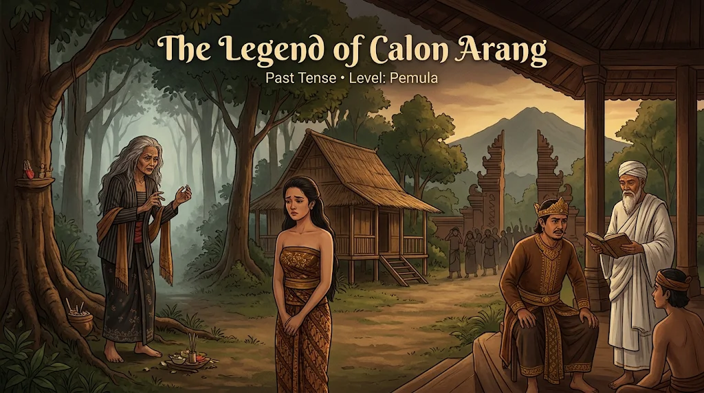

Long ago, an old woman named Calon Arang lived in a village in East Java. She had a beautiful daughter named Ratna Manggali, but nobody wanted to marry her.

The villagers were afraid of Calon Arang because she knew black magic. They said she was a wicked witch, so they stayed away from her family.

Calon Arang felt angry and sad. She went to the forest and prayed to a bad goddess for power.

Soon, a terrible sickness spread through the kingdom of King Airlangga. Many people got sick, and the village became quiet and scary.

The king was worried, so he asked a wise priest named Mpu Bharada for help. The priest decided to make a plan.

Mpu Bharada sent his student to marry Ratna Manggali. The young man learned the secret of the magic book and brought it to the priest.

Then Mpu Bharada met Calon Arang and used the book to defeat her bad power. The sickness left the kingdom, and the people lived in peace again.

Moral: Hatred and anger only bring pain, so we must always be kind to others.

## Vocab
long ago: dahulu kala
lived: tinggal (verb-2)
had: mempunyai (verb-2 tidak beraturan, dari have)
daughter: anak perempuan
marry: menikahi
afraid: takut
black magic: ilmu hitam
knew: tahu, menguasai (verb-2 tidak beraturan, dari know)
wicked: jahat
witch: penyihir
said: berkata (verb-2 tidak beraturan, dari say)
stayed away: menjauh (verb-2)
felt: merasa (verb-2 tidak beraturan, dari feel)
angry: marah
went: pergi (verb-2 tidak beraturan, dari go)
prayed: berdoa (verb-2)
goddess: dewi
power: kekuatan
terrible: mengerikan
sickness: penyakit
spread: menyebar (verb-2 tidak beraturan, dari spread)
got: menjadi (verb-2 tidak beraturan, dari get)
became: menjadi (verb-2 tidak beraturan, dari become)
scary: menakutkan
worried: khawatir
priest: pendeta
decided: memutuskan (verb-2)
plan: rencana
sent: mengirim (verb-2 tidak beraturan, dari send)
student: murid
learned: mempelajari (verb-2)
secret: rahasia
brought: membawa (verb-2 tidak beraturan, dari bring)
met: bertemu (verb-2 tidak beraturan, dari meet)
used: menggunakan (verb-2)
defeat: mengalahkan
hatred: kebencian

## Quiz

Q: Who was Ratna Manggali?
- [ ] A priest
- [x] The daughter of Calon Arang
- [ ] The queen of Airlangga

Q: Why were the villagers afraid of Calon Arang?
- [ ] She was very rich
- [ ] She was very loud
- [x] She knew black magic

Q: Where did Calon Arang go to pray?
- [x] To the forest
- [ ] To the palace
- [ ] To the sea

Q: Choose the correct past tense sentence:
- [ ] Calon Arang feel angry and sad.
- [x] Calon Arang felt angry and sad.
- [ ] Calon Arang feeling angry and sad.

Q: Complete the sentence: Calon Arang ___ to the forest.
- [ ] go
- [ ] going
- [x] went

Q: What did the king ask the wise priest to do?
- [x] Help the kingdom
- [ ] Build a palace
- [ ] Sail across the sea

Q: What is the past tense of "bring"?
- [ ] bringed
- [x] brought
- [ ] bringing

Q: Complete the sentence: Mpu Bharada ___ Calon Arang and used the book.
- [ ] meet
- [x] met
- [ ] meeting

Q: What is the moral of the story?
- [ ] Magic is always useful
- [x] We must always be kind to others
- [ ] Never talk to old women
