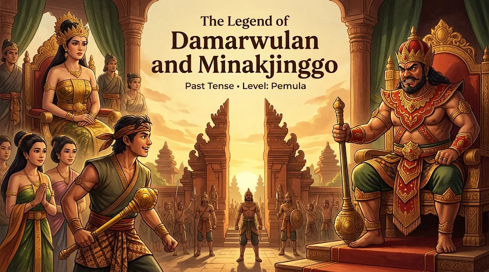

Long ago, a kind young man named Damarwulan lived in the Majapahit kingdom. He worked as a stable boy for a rich man, but he was brave and clever.

At that time, Queen Kencanawungu ruled Majapahit. A cruel king named Minakjinggo attacked the kingdom, and many people felt afraid.

The queen was worried, so she made an announcement. She said, "Whoever defeats Minakjinggo will marry me and rule the kingdom."

Many strong men tried, but all of them lost. Then Damarwulan heard the news and decided to go to the battle.

On his way, Damarwulan met two beautiful women who helped him. They gave him a special weapon and taught him a clever plan.

Damarwulan went to Minakjinggo's palace and fought him bravely. At last, he used the weapon and defeated the cruel king.

He returned to Majapahit and told the queen the good news. The people cheered, and the queen kept her promise.

Damarwulan married Queen Kencanawungu, and they ruled the kingdom with kindness.

Moral: Bravery and a good heart can win against evil.

## Vocab
long ago: dahulu kala
kind: baik hati
lived: tinggal (verb-2)
kingdom: kerajaan
worked: bekerja (verb-2)
stable boy: pengurus kuda
rich: kaya
brave: berani
clever: cerdik
queen: ratu
ruled: memerintah (verb-2)
cruel: kejam
attacked: menyerang (verb-2)
felt: merasa (verb-2 tidak beraturan, dari feel)
afraid: takut
worried: khawatir
made: membuat (verb-2 tidak beraturan, dari make)
announcement: pengumuman
said: berkata (verb-2 tidak beraturan, dari say)
defeat: mengalahkan
marry: menikahi
tried: mencoba (verb-2)
lost: kalah (verb-2 tidak beraturan, dari lose)
heard: mendengar (verb-2 tidak beraturan, dari hear)
decided: memutuskan (verb-2)
battle: pertempuran
met: bertemu (verb-2 tidak beraturan, dari meet)
helped: membantu (verb-2)
gave: memberi (verb-2 tidak beraturan, dari give)
weapon: senjata
taught: mengajar (verb-2 tidak beraturan, dari teach)
went: pergi (verb-2 tidak beraturan, dari go)
fought: bertarung (verb-2 tidak beraturan, dari fight)
used: menggunakan (verb-2)
returned: kembali (verb-2)
told: memberi tahu (verb-2 tidak beraturan, dari tell)
cheered: bersorak (verb-2)
kept: menepati (verb-2 tidak beraturan, dari keep)
promise: janji
evil: kejahatan

## Quiz

Q: Where did Damarwulan live?
- [ ] In Kediri
- [x] In the Majapahit kingdom
- [ ] On an island

Q: What was Damarwulan's job at first?
- [ ] A soldier
- [x] A stable boy
- [ ] A priest

Q: Who attacked the kingdom?
- [ ] Ken Arok
- [ ] Calon Arang
- [x] Minakjinggo

Q: Choose the correct past tense sentence:
- [ ] Damarwulan hear the news.
- [x] Damarwulan heard the news.
- [ ] Damarwulan hearing the news.

Q: Complete the sentence: Damarwulan ___ to Minakjinggo's palace.
- [ ] go
- [ ] going
- [x] went

Q: What did the two women give Damarwulan?
- [x] A special weapon
- [ ] A big boat
- [ ] A bag of gold

Q: What is the past tense of "teach"?
- [ ] teached
- [x] taught
- [ ] teaching

Q: Complete the sentence: The queen ___ her promise.
- [ ] keep
- [x] kept
- [ ] keeping

Q: What is the moral of the story?
- [ ] Queens are always right
- [x] Bravery and a good heart can win
- [ ] Never go to battle
