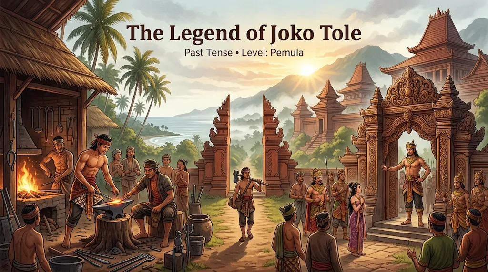

Long ago, a clever boy named Joko Tole lived on the island of Madura. His father was a famous blacksmith, so Joko Tole learned to make tools from a young age.

When he grew up, he became a strong and skilled young man. He helped the villagers and worked hard every day.

One day, the king of Majapahit asked for a special gate for his palace. The king said, "Who can make a beautiful gate for me?"

Joko Tole heard the news and decided to try. He traveled to the palace and showed his skill to the king.

The king was impressed, so he gave Joko Tole a difficult task. Joko Tole worked day and night and made a very beautiful gate.

The king smiled and said, "This is the best gate I ever saw!" He gave Joko Tole many gifts and a high position.

Later, Joko Tole married a princess named Dewi Ratnadi. They lived happily and helped many people.

The people of Madura remembered Joko Tole as a great and humble hero.

Moral: Skill and hard work bring success, so we must never stop learning.

## Vocab
long ago: dahulu kala
clever: cerdas
lived: tinggal (verb-2)
island: pulau
famous: terkenal
blacksmith: pandai besi
learned: belajar (verb-2)
tools: peralatan
grew up: tumbuh dewasa (verb-2 tidak beraturan, dari grow up)
became: menjadi (verb-2 tidak beraturan, dari become)
skilled: terampil
helped: membantu (verb-2)
worked: bekerja (verb-2)
asked: meminta (verb-2)
special: istimewa
gate: gerbang
palace: istana
said: berkata (verb-2 tidak beraturan, dari say)
heard: mendengar (verb-2 tidak beraturan, dari hear)
decided: memutuskan (verb-2)
traveled: bepergian (verb-2)
showed: menunjukkan (verb-2)
impressed: terkesan
gave: memberi (verb-2 tidak beraturan, dari give)
difficult: sulit
task: tugas
made: membuat (verb-2 tidak beraturan, dari make)
smiled: tersenyum (verb-2)
saw: melihat (verb-2 tidak beraturan, dari see)
position: jabatan
married: menikahi (verb-2)
remembered: mengingat (verb-2)
humble: rendah hati
hero: pahlawan

## Quiz

Q: Where did Joko Tole live?
- [ ] In Surabaya
- [x] On the island of Madura
- [ ] In Kediri

Q: What was Joko Tole's father?
- [ ] A farmer
- [ ] A fisherman
- [x] A blacksmith

Q: What did the king of Majapahit ask for?
- [ ] A big boat
- [x] A special gate
- [ ] A golden sword

Q: Choose the correct past tense sentence:
- [ ] Joko Tole work hard every day.
- [x] Joko Tole worked hard every day.
- [ ] Joko Tole working hard every day.

Q: Complete the sentence: Joko Tole ___ the news and decided to try.
- [ ] hear
- [ ] hearing
- [x] heard

Q: What is the past tense of "make"?
- [ ] maked
- [x] made
- [ ] making

Q: Complete the sentence: The king ___ Joko Tole many gifts.
- [x] gave
- [ ] give
- [ ] giving

Q: Who did Joko Tole marry?
- [ ] A farmer's daughter
- [x] A princess
- [ ] A queen of Kediri

Q: What is the moral of the story?
- [ ] Kings are always kind
- [ ] Never leave your island
- [x] Skill and hard work bring success
