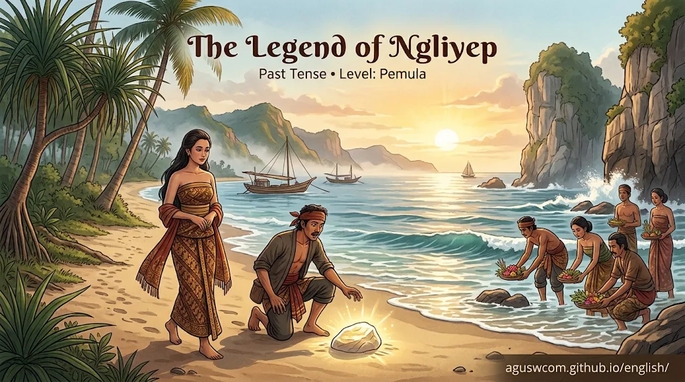

Long ago, a beautiful young woman named Dewi Kunti lived near the south coast of Java. She loved the sea, and she often walked on the beach in the morning.

One day, a fisherman found a strange stone on the sand. He took it home, and he showed it to his family.

That night, a bright light came from the stone. The fisherman felt afraid, so he went back to the beach and put the stone on the ground.

Then, a gentle voice spoke from the sea. It said, "This place is special, so please keep it clean and safe."

The next morning, the fisherman told the villagers about the voice. They listened carefully, and they promised to protect the beach.

From that day, the villagers made small offerings to the sea. They also cleaned the beach and took care of the trees near it.

The sea stayed calm, and the fishermen caught many fish. The village became rich and happy.

People still visit the beach today, and they remember the old story.

Moral: When we respect nature, nature takes care of us.

## Vocab
long ago: dahulu kala
beautiful: cantik
young woman: wanita muda
lived: tinggal (verb-2)
coast: pantai, pesisir
loved: menyukai, mencintai (verb-2)
walked: berjalan (verb-2)
fisherman: nelayan
found: menemukan (verb-2 tidak beraturan, dari find)
strange: aneh
stone: batu
sand: pasir
took: mengambil, membawa (verb-2 tidak beraturan, dari take)
showed: menunjukkan (verb-2)
bright: terang
came: datang (verb-2 tidak beraturan, dari come)
felt: merasa (verb-2 tidak beraturan, dari feel)
afraid: takut
went: pergi (verb-2 tidak beraturan, dari go)
put: meletakkan (verb-2 tidak beraturan, dari put)
gentle: lembut
spoke: berbicara (verb-2 tidak beraturan, dari speak)
special: istimewa
told: memberi tahu (verb-2 tidak beraturan, dari tell)
listened: mendengarkan (verb-2)
promised: berjanji (verb-2)
protect: melindungi
offerings: sesajen, persembahan
made: membuat (verb-2 tidak beraturan, dari make)
caught: menangkap (verb-2 tidak beraturan, dari catch)
respect: menghormati

## Quiz

Q: Where did Dewi Kunti live?
- [x] Near the south coast of Java
- [ ] On a high mountain
- [ ] In a big city

Q: What did the fisherman find on the sand?
- [x] A strange stone
- [ ] A big fish
- [ ] A small boat

Q: Why did the fisherman feel afraid?
- [x] A bright light came from the stone
- [ ] A big wave hit his house
- [ ] He lost his fish

Q: Choose the correct past tense sentence:
- [ ] The fisherman find a stone.
- [x] The fisherman found a stone.
- [ ] The fisherman finding a stone.

Q: Complete the sentence: A gentle voice ___ from the sea.
- [ ] speak
- [x] spoke
- [ ] speaking

Q: What did the villagers promise to do?
- [x] Protect the beach
- [ ] Leave the village
- [ ] Sell the stone

Q: What is the past tense of "catch"?
- [ ] catched
- [x] caught
- [ ] catching

Q: Complete the sentence: The fishermen ___ many fish.
- [x] caught
- [ ] catch
- [ ] catches

Q: What is the moral of the story?
- [x] When we respect nature, nature takes care of us
- [ ] The sea is always dangerous
- [ ] Never go to the beach
