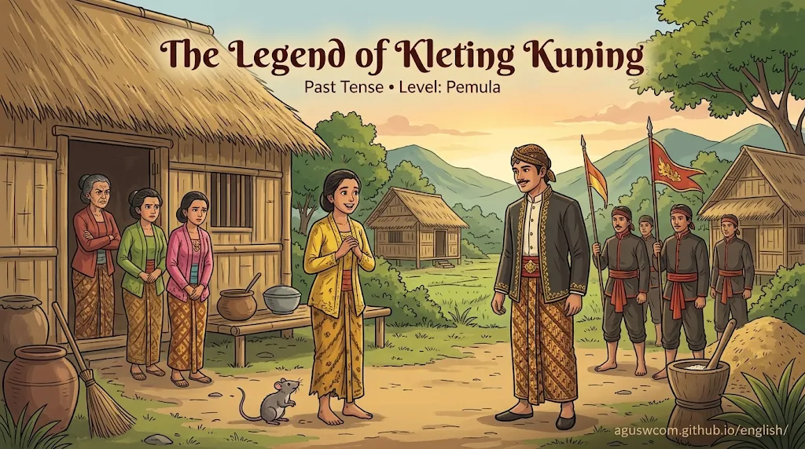

Long ago, a kind girl named Kleting Kuning lived in a small village. Her mother died when she was young, so she lived with her stepmother and two stepsisters.

Her stepmother was cruel. Every day, Kleting Kuning cooked, washed the clothes, and cleaned the house. Her stepsisters did nothing and only played.

One day, a handsome prince visited the village. He looked for a wife, and all the girls wanted to meet him.

The stepmother locked Kleting Kuning in the kitchen. She wanted the prince to choose one of her own daughters.

Kleting Kuning cried, but she did not give up. She wore her old yellow dress and sat quietly in the kitchen.

Then a small mouse came and helped her. It opened the door, and Kleting Kuning ran outside.

The prince saw her in the yellow dress and smiled. He talked to her, and he knew she had a good heart.

The prince chose Kleting Kuning as his wife. The stepmother and the stepsisters felt ashamed, and they said sorry.

Moral: Kindness and patience always bring a happy ending.

## Vocab
long ago: dahulu kala
lived: tinggal (verb-2)
kind: baik hati
died: meninggal (verb-2)
stepmother: ibu tiri
stepsisters: saudari tiri
cruel: kejam
cooked: memasak (verb-2)
washed: mencuci (verb-2)
cleaned: membersihkan (verb-2)
visited: berkunjung (verb-2)
looked for: mencari (verb-2)
locked: mengunci (verb-2)
cried: menangis (verb-2)
wore: memakai (verb-2 tidak beraturan, dari wear)
sat: duduk (verb-2 tidak beraturan, dari sit)
mouse: tikus
helped: membantu (verb-2)
ran: berlari (verb-2 tidak beraturan, dari run)
saw: melihat (verb-2 tidak beraturan, dari see)
chose: memilih (verb-2 tidak beraturan, dari choose)
ashamed: malu
patience: kesabaran

## Quiz

Q: Where did Kleting Kuning live?
- [x] In a small village
- [ ] In a big castle
- [ ] In a forest

Q: Who lived with Kleting Kuning?
- [x] Her stepmother and two stepsisters
- [ ] Her father and her brother
- [ ] Her grandmother and her aunt

Q: Choose the correct past tense sentence:
- [ ] Kleting Kuning cook every day.
- [x] Kleting Kuning cooked every day.
- [ ] Kleting Kuning cooking every day.

Q: Why did the stepmother lock Kleting Kuning in the kitchen?
- [x] She wanted the prince to choose her own daughters
- [ ] She wanted Kleting Kuning to cook for the prince
- [ ] She wanted Kleting Kuning to rest

Q: Complete the sentence: Kleting Kuning ___ her old yellow dress.
- [ ] wear
- [x] wore
- [ ] wearing

Q: Who helped Kleting Kuning open the door?
- [ ] A cat
- [x] A mouse
- [ ] A bird

Q: What is the past tense of "choose"?
- [ ] choosed
- [ ] chosen
- [x] chose

Q: Complete the sentence: The prince ___ Kleting Kuning in the yellow dress.
- [x] saw
- [ ] see
- [ ] seeing

Q: What is the moral of the story?
- [x] Kindness and patience always bring a happy ending
- [ ] Cruel people always win
- [ ] Never go outside your house
