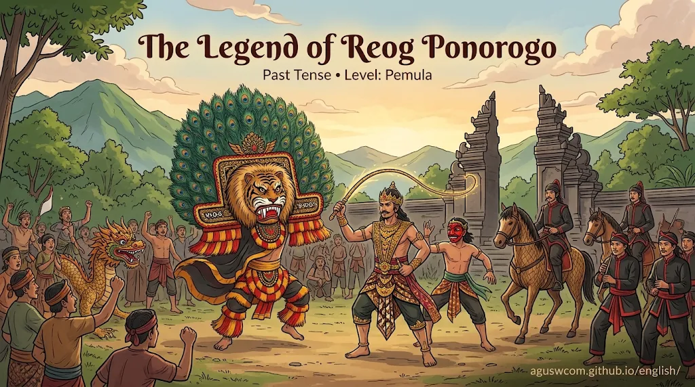

Long ago, a young king named Kelono Sewandono ruled the kingdom of Bantarangin. He was handsome and brave, and his people loved him.

One day, the king heard about a beautiful princess named Dewi Songgolangit. She lived in the kingdom of Kediri, so he decided to marry her.

The king sent his men to Kediri with a letter. The princess read it and said, "I will marry you, but you must bring me a special gift."

She asked for an amazing dance with a two-headed animal and many horse dancers. The king felt worried, but he promised to do it.

Then the king traveled to Kediri with his soldiers and his friend Bujang Anom. On the way, a fierce lion king named Singa Barong stopped them.

Singa Barong wanted the princess too, so they fought for a long time. At last, the king used his magic whip and won the fight.

Singa Barong became weak and followed the king. He wore a big peacock on his head and danced for the princess.

The people loved the dance very much, and they called it Reog. People in Ponorogo still perform it today.

Moral: Hard work and bravery help us reach our dreams.

## Vocab
long ago: dahulu kala
king: raja
ruled: memerintah (verb-2)
kingdom: kerajaan
handsome: tampan
brave: berani
loved: mencintai (verb-2)
heard: mendengar (verb-2 tidak beraturan, dari hear)
beautiful: cantik
princess: putri
lived: tinggal (verb-2)
decided: memutuskan (verb-2)
marry: menikahi
sent: mengirim (verb-2 tidak beraturan, dari send)
letter: surat
read: membaca (verb-2 tidak beraturan, dari read, dibaca "red")
said: berkata (verb-2 tidak beraturan, dari say)
special: istimewa
gift: hadiah
asked: meminta (verb-2)
amazing: menakjubkan
felt: merasa (verb-2 tidak beraturan, dari feel)
worried: khawatir
promised: berjanji (verb-2)
traveled: bepergian (verb-2)
fierce: garang
stopped: menghentikan (verb-2)
fought: bertarung (verb-2 tidak beraturan, dari fight)
used: menggunakan (verb-2)
whip: cambuk
won: menang (verb-2 tidak beraturan, dari win)
became: menjadi (verb-2 tidak beraturan, dari become)
weak: lemah
followed: mengikuti (verb-2)
wore: memakai (verb-2 tidak beraturan, dari wear)
peacock: burung merak
danced: menari (verb-2)
perform: menampilkan

## Quiz

Q: Who ruled the kingdom of Bantarangin?
- [ ] Singa Barong
- [x] Kelono Sewandono
- [ ] Bujang Anom

Q: Where did Dewi Songgolangit live?
- [x] In Kediri
- [ ] In Surabaya
- [ ] In Bantarangin

Q: What did the princess ask for?
- [ ] A big house
- [ ] Gold and silver
- [x] A special dance

Q: Choose the correct past tense sentence:
- [ ] The king decide to marry her.
- [x] The king decided to marry her.
- [ ] The king deciding to marry her.

Q: Complete the sentence: The king ___ about the beautiful princess.
- [ ] hear
- [x] heard
- [ ] hearing

Q: Who stopped the king on the way?
- [ ] A big snake
- [x] Singa Barong
- [ ] The princess

Q: What is the past tense of "win"?
- [ ] winned
- [x] won
- [ ] winning

Q: Complete the sentence: Singa Barong ___ a big peacock on his head.
- [ ] wear
- [ ] wearing
- [x] wore

Q: What is the moral of the story?
- [ ] Lions are always weak
- [x] Hard work and bravery help us reach our dreams
- [ ] Never travel far away
