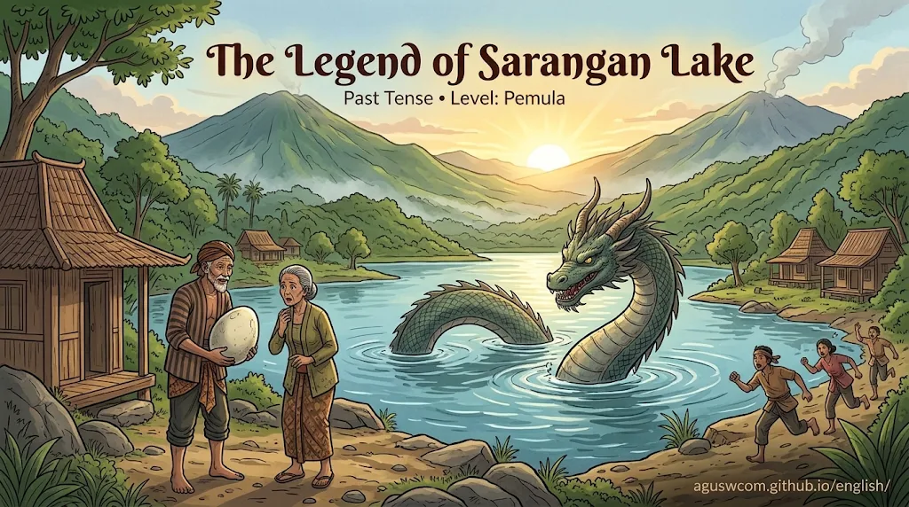

Long ago, a kind old man named Ki Pasir and his wife Nyai Pasir lived on the slope of Mount Lawu. They were poor, but they were honest and friendly.

One day, Ki Pasir went to the forest to look for food. He found a big egg under a tree and took it home.

The couple cooked the egg and ate it. After that, Nyai Pasir felt strange, and a small snake began to grow in her stomach.

The snake grew very big and became a huge dragon. The villagers were afraid, so they ran away from the village.

One day, the dragon ate too much and its body hurt. It started to move on the ground and shook the whole village.

Heavy rain came, and the water covered the village. The houses sank, and a beautiful lake appeared at the foot of the mountain.

The people called the lake Sarangan. Today, many visitors come to enjoy the cool air and the clear water.

Moral: Be careful with strange things, and always think before you act.

## Vocab
long ago: dahulu kala
kind: baik hati
slope: lereng
lived: tinggal (verb-2)
poor: miskin
honest: jujur
friendly: ramah
went: pergi (verb-2 tidak beraturan, dari go)
forest: hutan
found: menemukan (verb-2 tidak beraturan, dari find)
egg: telur
took: mengambil, membawa (verb-2 tidak beraturan, dari take)
cooked: memasak (verb-2)
ate: makan (verb-2 tidak beraturan, dari eat)
felt: merasa (verb-2 tidak beraturan, dari feel)
strange: aneh
snake: ular
began: mulai (verb-2 tidak beraturan, dari begin)
grew: tumbuh (verb-2 tidak beraturan, dari grow)
became: menjadi (verb-2 tidak beraturan, dari become)
huge: sangat besar
dragon: naga
villagers: penduduk desa
afraid: takut
ran: berlari (verb-2 tidak beraturan, dari run)
hurt: sakit, terluka
shook: mengguncang (verb-2 tidak beraturan, dari shake)
heavy rain: hujan lebat
came: datang (verb-2 tidak beraturan, dari come)
covered: menutupi (verb-2)
sank: tenggelam (verb-2 tidak beraturan, dari sink)
appeared: muncul (verb-2)
clear: jernih
careful: hati-hati

## Quiz

Q: Where did Ki Pasir and Nyai Pasir live?
- [ ] Near the sea
- [x] On the slope of Mount Lawu
- [ ] In a big city

Q: What did Ki Pasir find in the forest?
- [ ] A small fish
- [x] A big egg
- [ ] A golden stone

Q: What grew in Nyai Pasir's stomach?
- [ ] A bird
- [ ] A fish
- [x] A snake

Q: Choose the correct past tense sentence:
- [ ] Ki Pasir find a big egg.
- [x] Ki Pasir found a big egg.
- [ ] Ki Pasir finding a big egg.

Q: Complete the sentence: The couple ___ the egg.
- [ ] eat
- [x] ate
- [ ] eating

Q: What is the past tense of "grow"?
- [ ] growed
- [ ] growing
- [x] grew

Q: Complete the sentence: The villagers ___ away from the village.
- [x] ran
- [ ] run
- [ ] running

Q: What appeared at the foot of the mountain?
- [ ] A big river
- [x] A beautiful lake
- [ ] A tall tower

Q: What is the moral of the story?
- [ ] Dragons are friendly
- [x] Think before you act
- [ ] Never go to the forest
