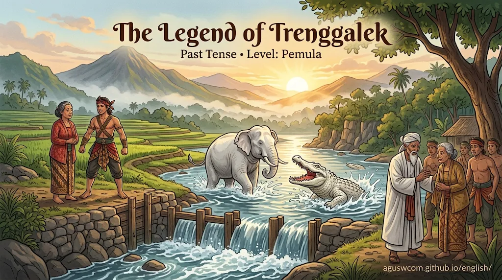

Long ago, a kind old woman named Mbok Randa lived in a small village in East Java. She had a big white elephant, and she loved it very much.

In the same area, there lived a brave young man named Menak Sopal. He was strong and always helped other people.

One year, the villagers had no water for their rice fields. Menak Sopal and the young men decided to build a dam in the river.

They finished the dam, but it broke suddenly. They built it again, and it broke again.

Menak Sopal looked into the water and saw a huge white crocodile. The crocodile hit the dam with its tail and broke it.

Menak Sopal needed a strong animal to fight the crocodile, so he asked Mbok Randa for help. She lent him her white elephant.

The elephant fought the crocodile, and the dam stood strong at last. But the elephant died in the fight, and Mbok Randa felt very sad.

A wise man named Ki Ageng Sinawang spoke to her kindly. He said her elephant died for a good reason, so Mbok Randa accepted it with a big heart.

The villagers never forgot her kindness. They named the place Trenggalek, from the words "teranging galih," which means a clear and kind heart.

Moral: A big heart can bring happiness to many people.

## Vocab
long ago: dahulu kala
kind: baik hati
lived: tinggal (verb-2)
had: mempunyai (verb-2 tidak beraturan, dari have)
elephant: gajah
loved: menyayangi (verb-2)
brave: berani
strong: kuat
helped: membantu (verb-2)
villagers: penduduk desa
rice fields: sawah
decided: memutuskan (verb-2)
build: membangun
dam: bendungan
finished: menyelesaikan (verb-2)
broke: patah, jebol (verb-2 tidak beraturan, dari break)
built: membangun (verb-2 tidak beraturan, dari build)
looked: melihat (verb-2)
saw: melihat (verb-2 tidak beraturan, dari see)
huge: sangat besar
crocodile: buaya
hit: memukul (verb-2 tidak beraturan, dari hit)
tail: ekor
needed: membutuhkan (verb-2)
asked: meminta (verb-2)
lent: meminjamkan (verb-2 tidak beraturan, dari lend)
fought: bertarung (verb-2 tidak beraturan, dari fight)
stood: berdiri, bertahan (verb-2 tidak beraturan, dari stand)
died: mati (verb-2)
felt: merasa (verb-2 tidak beraturan, dari feel)
wise: bijaksana
spoke: berbicara (verb-2 tidak beraturan, dari speak)
accepted: menerima (verb-2)
forgot: melupakan (verb-2 tidak beraturan, dari forget)
named: menamai (verb-2)
heart: hati

## Quiz

Q: What did Mbok Randa have?
- [ ] A white horse
- [x] A white elephant
- [ ] A white crocodile

Q: Why did the villagers build a dam?
- [ ] To catch fish
- [x] To get water for the rice fields
- [ ] To stop a big wave

Q: Who broke the dam?
- [ ] A big snake
- [ ] A group of villagers
- [x] A white crocodile

Q: Choose the correct past tense sentence:
- [ ] The dam break suddenly.
- [x] The dam broke suddenly.
- [ ] The dam breaking suddenly.

Q: Complete the sentence: Menak Sopal ___ a huge white crocodile in the water.
- [ ] see
- [ ] seeing
- [x] saw

Q: What is the past tense of "build"?
- [ ] builded
- [x] built
- [ ] building

Q: Complete the sentence: Mbok Randa ___ her white elephant to Menak Sopal.
- [x] lent
- [ ] lend
- [ ] lending

Q: What is the past tense of "fight"?
- [ ] fighted
- [ ] fighting
- [x] fought

Q: What is the moral of the story?
- [ ] Crocodiles are always dangerous
- [ ] Never build a dam
- [x] A big heart can bring happiness
