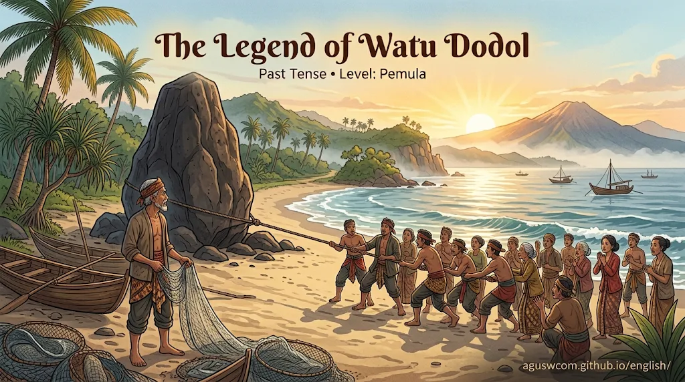

Long ago, a kind fisherman named Pak Darto lived in a small village near the sea in Banyuwangi. He was poor, but he was honest and hardworking.

Every day, he went to the sea and caught fish for his family. One morning, he found a strange big stone on the beach.

The stone looked like a sweet cake, and it was very hard. The fisherman felt confused, so he went home and told the villagers.

The villagers came to see the stone and laughed at it. They said, "It is only a useless rock, so let us move it away."

They pushed and pulled the stone for many hours. However, the stone did not move, and everybody became tired.

That night, the fisherman had a dream. A wise old man said, "The stone is special, so please keep it safe."

The next day, the fisherman told the villagers about his dream. They felt sorry, and they decided to leave the stone on the beach.

Today, people call it Watu Dodol. Many visitors come to see it and enjoy the beautiful sea.

Moral: Never laugh at things we do not understand, and always respect nature.

## Vocab
long ago: dahulu kala
kind: baik hati
fisherman: nelayan
lived: tinggal (verb-2)
village: desa
poor: miskin
honest: jujur
hardworking: pekerja keras
went: pergi (verb-2 tidak beraturan, dari go)
caught: menangkap (verb-2 tidak beraturan, dari catch)
found: menemukan (verb-2 tidak beraturan, dari find)
strange: aneh
stone: batu
beach: pantai
looked like: terlihat seperti
sweet cake: kue manis
hard: keras
felt: merasa (verb-2 tidak beraturan, dari feel)
confused: bingung
told: memberi tahu (verb-2 tidak beraturan, dari tell)
villagers: penduduk desa
came: datang (verb-2 tidak beraturan, dari come)
laughed: menertawakan (verb-2)
said: berkata (verb-2 tidak beraturan, dari say)
useless: tidak berguna
pushed: mendorong (verb-2)
pulled: menarik (verb-2)
became: menjadi (verb-2 tidak beraturan, dari become)
tired: lelah
had: mempunyai (verb-2 tidak beraturan, dari have)
dream: mimpi
wise: bijaksana
special: istimewa
sorry: menyesal
decided: memutuskan (verb-2)
respect: menghormati
nature: alam

## Quiz

Q: Where did Pak Darto live?
- [ ] In a big city
- [x] In a village near the sea
- [ ] On a mountain

Q: What did Pak Darto find on the beach?
- [ ] A big fish
- [x] A strange stone
- [ ] A small boat

Q: What did the villagers do to the stone?
- [ ] They sold it
- [ ] They painted it
- [x] They tried to move it

Q: Choose the correct past tense sentence:
- [ ] Pak Darto find a strange stone.
- [x] Pak Darto found a strange stone.
- [ ] Pak Darto finding a strange stone.

Q: Complete the sentence: The fisherman ___ fish for his family.
- [ ] catch
- [ ] catching
- [x] caught

Q: What is the past tense of "tell"?
- [ ] telled
- [x] told
- [ ] telling

Q: Complete the sentence: The fisherman ___ a dream that night.
- [x] had
- [ ] have
- [ ] having

Q: What did the villagers decide to do?
- [ ] Break the stone
- [x] Leave the stone on the beach
- [ ] Take the stone home

Q: What is the moral of the story?
- [ ] Stones are always useless
- [ ] Never go to the beach
- [x] Respect nature and things we do not understand
